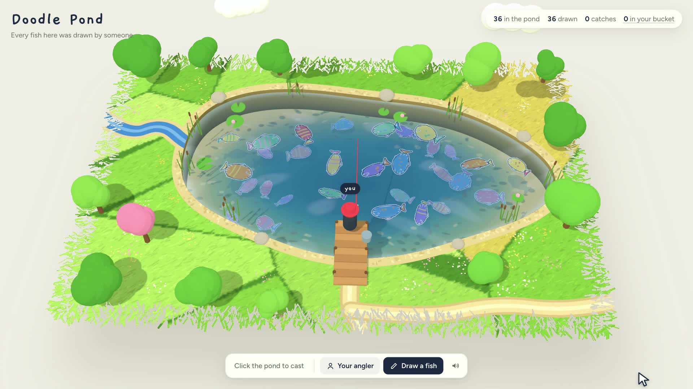

# Doodle Pond

Draw a fish, release it into a pond everyone shares, and try to catch everyone else's.

**Play it at [doodlepond.pages.dev](https://doodlepond.pages.dev).** It works on phones and laptops, with no sign-up.

[](promo/doodle-pond-demo.mp4)

A painted 3D diorama made with three.js, with a small design-tool style UI on top. Every fish was drawn by someone. Catch one and you can keep it, which takes it out of the pond for everyone else.

- **Draw**: sketch a fish facing right, name it, release it. It drops into the pond and swims off.
- **Fish**: click the water to cast. Wait through the nibbles, then click when the bobber dips and the red `!` appears; you have 4 seconds, and a missed bite just comes back for another nibble. Hold to reel, and let go if the line gets tight. Lines never snap and hooked fish never escape: easing off is a little faster, but holding or not reeling at all still lands the fish.
- **Catch card**: see who drew it and how many times it has been caught, then **keep it in your bucket** or release it back.
- **Bucket**: keeping a fish takes it out of the shared pond **for everyone** until you release it. Click "in your bucket" at the top to see your fish and release any of them. The bucket holds 60 fish and belongs to this browser.
- **Your angler**: click your angler on the dock, or **Your angler** in the toolbar, to set a name, coat, hat, hat color, skin tone and rod. First-time visitors get a random look, saved in this browser.
- **Inspect**: click any fish for a design-tool style selection box with its size, artist and catch count.
- **Report**: the catch card has a Report button for drawings that shouldn't be there.

The header shows how many fish are **in the pond** right now (this drops when anyone keeps one), how many have ever been **drawn**, total **catches**, and your bucket. While fewer than 10 real fish are swimming, house fish fill the pond, so "in the pond" reads at least 10 and "drawn" counts only fish people drew.

There are no other players on screen. Everyone shares one pond through the database: the fish, the counts and who kept what.

Keys: `Space` hooks and reels, `D` opens the drawing sheet, `Esc` reels in or closes.

## Run it

```bash
npm install
npm run dev
```

On its own, `npm run dev` plays a **local pond**: ten house fish plus anything you draw, stored in this browser. Keeping and releasing work the same way as in the global pond.

To run the real global pond locally (static site, API and a local copy of the database), in a second terminal:

```bash
npm run db:local
npm run pond
```

`npm run pond` builds the site and serves it with the API on http://localhost:8788. While it's running, `npm run dev` also uses it, through the `/api` proxy in `vite.config.js`.

## Deploy (Cloudflare Pages + D1)

Everything runs on Cloudflare: the page is static, `functions/api/[[route]].js` is the API, and the fish live in a D1 database bound as `DB` in `wrangler.toml`. The browser never talks to the database directly.

```bash
npm run deploy
```

After changing `migrations/`, apply them to the live database with `npm run db:remote`.

### What the API enforces

- Clients only ever see swimming fish, and only `id, name, artist, strokes, catches, created_at`. Every write goes through an API route.
- Drawing a fish: names are trimmed to 24 characters, the drawing is validated (8–4000 points, at most 400 strokes, valid colors and sizes), and there's a cap of 60 new fish per minute for everyone and 20 per hour per IP.
- Keeping is one conditional update, so when two people land the same fish only the first wins. The other sees "Someone else took it home" and the fish wriggles free. Limits: 60 fish per bucket, 40 keeps per IP per hour, 120 keeps per minute for everyone, so a script can't drain the pond quickly.
- Each browser has a random secret owner key. Only its SHA-256 hash is stored with a kept fish, and only that key can release it or list it. It's sent in POST bodies, never in URLs. Clearing site data loses the key, and those fish stay kept.
- IPs come from Cloudflare's `cf-connecting-ip` header, which clients can't fake, and are stored only as salted hashes, only for the limits.
- Reports count once per IP per fish. 3 reports hide a fish, but at most 10 fish are auto-hidden per hour, so a script can't empty the pond. To review, query `select id, name, reports from fish where hidden = 1` in the D1 console, and set `hidden = 0` to restore one.
- Counters for drawn, swimming and catches are kept by triggers, so stats never count the table.
- While fewer than 10 real fish are swimming, the app tops the pond up with house fish by "pond keeper" and asks visitors to draw one. House fish never leave the pond: keeping one puts a copy in your bucket.
- Fish on your screen are checked every minute. Any that someone else kept swim off up the stream.

### How it scales

- **Any number of fish.** A visitor only renders a school sized to how much pond their window shows: about 12 fish on a phone, 28 on a laptop and 48 on a large monitor, capped at 64, and 30% fewer on devices with 4 cores or 4 GB of memory or less. Resizing the window adds fish or sends the extras home up the stream one at a time. The rest wait in a pool of up to 150, fetched 60 at a time: the newest plus random runs from across the table, refreshed every 3 minutes. Every 18 seconds one fish swims out up the stream and another swims in, so each fish gets its turn on screen.
- **Depth layers.** The school is split into up to 4 depth layers of about 16 fish each, added as the school grows. Fish keep their distance only from fish in the same layer and pass over and under the others. Deeper fish are slightly smaller and tinted toward the water color. A fish rises from its layer to take the bait.
- **Any number of anglers.** You don't see other players, so nothing is synced between them. The only shared writes are a catch `+1` and keep or release.
- **Requests.** One call loads the pond and one the bucket. After that, one "tick" a minute brings new fish, stats and which fish on screen are still swimming, plus a pond refresh every 3 minutes. A 10-minute visit is about 15 requests.
- **Free plan.** 100,000 function requests a day (about 6,000 ten-minute visits), 5 million D1 rows read a day and 5 GB of storage. Bandwidth and the static page are free. If the daily limit runs out, the API stops answering until midnight UTC and visitors get a local pond with house fish. Workers Paid ($5 a month) raises this to 10 million requests a month.

For a stress test of the local pond, open `http://localhost:5173/?stress=500`. Add `&school=48` to force the school size and see the layers on any window.

The link preview is `public/og.png` (1200×630). To make a new one, run `npm run dev` without the local API and take a 1200×630 screenshot of `http://localhost:5173/?shot&stress=40&school=34`. `?shot` hides the controls and shows the title card and URL; it only works in development. For example, with Chrome:

```bash
"/Applications/Google Chrome.app/Contents/MacOS/Google Chrome" --headless=new --use-angle=swiftshader --enable-unsafe-swiftshader --hide-scrollbars --window-size=1200,630 --virtual-time-budget=9000 --screenshot=public/og.png "http://localhost:5173/?shot&stress=40&school=34"
```

`promo/` holds a 45-second demo video (`doodle-pond-demo.mp4`, 1920×1080, 30 fps, silent) and its poster frame (`poster.jpg`), for posting on social media.

Before posting the link widely, consider Cloudflare Turnstile on the release button if bots start drawing.

## Code map

| File | What it does |
| --- | --- |
| `src/main.js` | Boots the app: school size, depth layers, catch card, bucket, stats, the minute tick |
| `src/world.js` | Painted meadow tile, pond, water shader, trees, dock, angler, camera fit |
| `src/fish.js` | Turns a drawing into a wiggling sticker, plus the swim behavior |
| `src/angler.js` | Cast → wait → nibble → bite → reel → leap state machine |
| `src/anglers.js` | Builds the angler figure from a look (coat, hat, skin, rod) |
| `src/customize.js` | "Your angler" sheet with a turntable preview |
| `src/studio.js` | Drawing sheet that produces a compact stroke list |
| `src/strokes.js` | Stroke format, validation and rendering, shared by the app and the API |
| `src/seed.js` | The 10 procedurally drawn house fish |
| `src/audio.js` | Synthesized sound effects, no audio files |
| `src/store/` | `local.js` and `cloudflare.js` behind one small interface, plus `bucket.js` (kept fish and the owner key) |
| `functions/api/[[route]].js` | The API: every rule and limit |
| `migrations/` | D1 tables, indexes and counter triggers |
| `public/` | Favicon, Apple touch icon and the `og.png` link preview |
| `promo/` | Demo video and poster |
